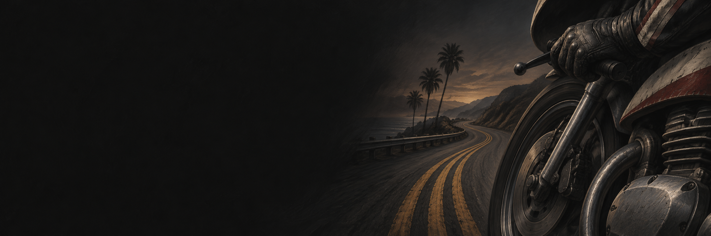
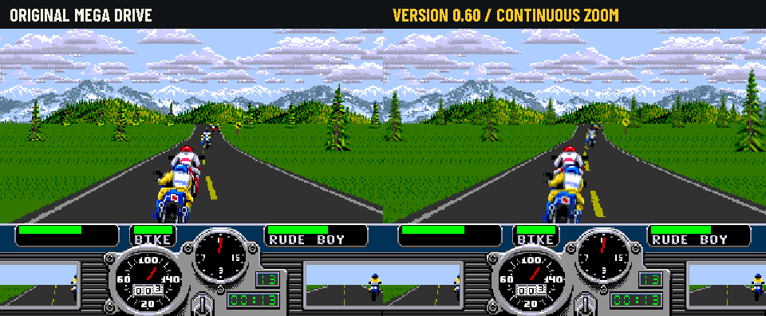
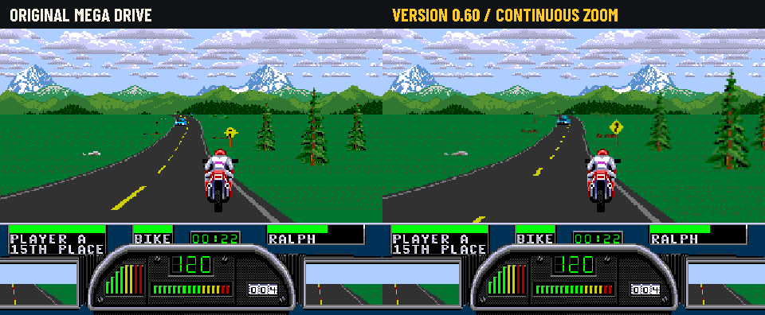
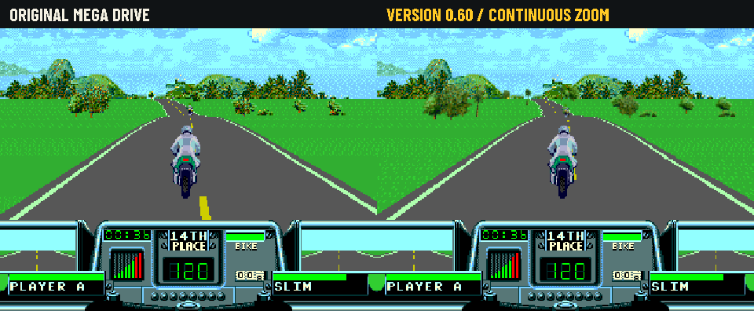

# Road Rash Trilogy Recomp

A native Windows x64 fan project for **Road Rash, Road Rash II and Road Rash 3**
from the Mega Drive / Genesis. Version **0.60** improves sprite approach and hill
placement, adds presentation enhancements to original local split screen, and
includes campaign checkpoints and looping remake music. The English installer
builds the games locally from your own ROMs.

## Install and play

**[Download version 0.60](https://github.com/BTr-RJ/RoadRashTrilogy_Recomp/releases/tag/v0.60)**
(Public Test, Windows x64):

- [Standard installer](https://github.com/BTr-RJ/RoadRashTrilogy_Recomp/releases/download/v0.60/RoadRashTrilogyRecomp-0.60-Windows-x64.zip)
- [Offline installer](https://github.com/BTr-RJ/RoadRashTrilogy_Recomp/releases/download/v0.60/RoadRashTrilogyRecomp-0.60-Windows-x64-offline.zip)
- [SHA-256 checksums](https://github.com/BTr-RJ/RoadRashTrilogy_Recomp/releases/download/v0.60/SHA256SUMS.txt)

1. Extract the complete **RoadRashTrilogyRecomp-0.60-Windows-x64.zip** package.
2. Open **RoadRashTrilogyRecomp.exe** and choose **Install games**.
3. Select your ROM folder(s) and an empty installation folder.
4. Let the installer verify your files and compile the supplied games locally.
5. Open the installed launcher, choose a ready title and press **Play**.

You must provide compatible original dumps. BIN, MD, GEN and ZIP are accepted.
**Only these verified revisions are supported: Road Rash (USA/Europe), Road Rash II
(USA/Europe, RR206), and Road Rash 3 (USA/Europe). Japanese ROMs, other regions or
revisions, modified images and interleaved SMD dumps are not supported.** Files
are identified by SHA-256, not by filename; renaming an unsupported ROM will not
make it compatible. See the exact hashes in `games/supported-roms.json`.
One folder may contain all three games; only supplied games are installed.
The package contains no ROMs or generated game code. No game files are downloaded.
Microsoft C++ tools are required; the installer prepares them if missing, through
Windows administrator consent. The offline package includes verified SDK caches
but requires Microsoft C++ tools to be installed already for fully offline use.

See [installation and supported revisions](docs/INSTALLATION.md),
[controls](docs/CONTROLS.md) and [building from source](docs/BUILDING.md).

## Original Mega Drive vs continuous zoom (0.60)

Each GIF shows the **same replay and the same captured frames** side by side:
**original Mega Drive rendering on the left**, **version 0.60 continuous zoom
on the right**. Both views use 4:3, matching inputs and normal game speed.
The original view uses the native raster renderer in this project's runtime.

### Road Rash

### Road Rash II

### Road Rash 3

Captured with the release-qualified 0.60 local builds. Each pair preserves guest RAM/VRAM
and the HUD. The 4-second GIFs sample the 59.94 Hz capture at 50 fps, retaining
the original elapsed time. The native panel is pixel-verified; GIF palette
quantization approximates some fractional edge colors on the 0.60 panel. [Capture details and hashes](docs/media/0.60/comparison.json).

## What changed from 0.50

- More stable scenery, obstacles, opponents and traffic during approach, with
  fractional sprite coverage and fewer unnecessary source/bitmap switches.
- Corrected road-relative placement and stale hill geometry across climbs,
  descents and crests.
- Independent presentation enhancements for the original RR2/RR3 local
  split-screen modes. RR1 keeps its alternating-player mode.
- Automatic checkpoints after campaign races; **F1** or Player 1 **R2 / RT** loads
  the latest state. Checkpoints require the exact executable/ROM that saved them.
- Verified bundled remake tracks omit the common non-musical outro and loop at
  the musical ending. Original music remains selectable.
- Authored shader effects with correct widescreen canvas aspect; the authored
  4:3 presentation remains available, without extra engine color correction.
- A reproducible C11 emitter fix for the reported installation initializer error.

See [0.60 changes, validation and update notes](docs/RELEASE-0.60.md).

## Features

- Classic trilogy covers, a sober dark launcher and native Windows navigation.
- Remappable keyboard/controller inputs for two original player ports, including
  button/axis capture, controller assignment, deadzone and 3-/6-button pad options.
- Continuous scenery and vehicle zoom, road/marking smoothing and short visual
  prediction in recognized single-player and original RR2/RR3 split-screen races,
  preserving original game speed.
- Source-art margin recovery, continuous approach scaling and road-anchored
  vehicles on curves and hills, preserving the original animation poses.
- Optional experimental 16:9 expansion, resolution selection and CRT filters
  through librashader / koko-aio.
- Original sound and optional local remake music, independent volume settings,
  and local achievements with an in-game F6 panel.

The games execute translated 68000 code with fallback for remaining paths.
Complete static coverage and full campaign validation are not claimed. Menus,
and paused motion retain native behavior. Original RR2/RR3 split screen uses
independent enhanced camera views when continuous zoom is enabled.
Network multiplayer is not implemented. Windows release installers include 18
Dean Harris remake tracks, installed locally with no separate music download.
The original soundtrack remains selectable. See [music](music/README.md) and
[0.60 scope and validation](docs/RELEASE-0.60.md).

## Source repository

The repository follows the local-build distribution model of
[BTr-RJ/RedBaron_Recomp](https://github.com/BTr-RJ/RedBaron_Recomp): integration
source, patches, tests and installer tools are public; user-owned game inputs
and generated game code remain local. See the [build guide](docs/BUILDING.md)
for source navigation and reproducible build/test commands, and the
[video guide](docs/VIDEO.md) for presentation settings and limits.

| Directory | Purpose |
|---|---|
| src/launcher | Native English launcher, controls and installer UI |
| src/game | Per-game adapters and scene capture |
| src/presentation | Sprite zoom, terrain, road markings and GPU/CRT output |
| src/music, src/achievements | Audio enhancements and local progress |
| games | Exact revision hashes and public configuration metadata |
| tools, scripts | Verified bootstrap, local build, validation and packaging |
| patches | Reviewable pinned-runtime integration changes |
| tests | Synthetic pipeline, installation and native regression tests |
| docs, .github | User/build guides, license notices and source checks |

## Bugs and contributions

Report the launcher version, game revision/SHA-256, reproduction steps, Windows
version, GPU/controller and relevant log excerpt. Do not upload ROMs, generated
game code, saves or account credentials. Review private paths before sharing logs.
Read [CONTRIBUTING.md](CONTRIBUTING.md) before submitting a change.

## Credits and notices

This independent fan project is not an official Electronic Arts or Sega product.
Original games and artwork belong to their respective rights holders.
See [credits](CREDITS.md) and [third-party terms](THIRD_PARTY_NOTICES.md).
GenesisRecomp runtime terms are PolyForm Noncommercial 1.0.0; other components
retain their own licenses. Public visibility does not imply commercial-use rights.
